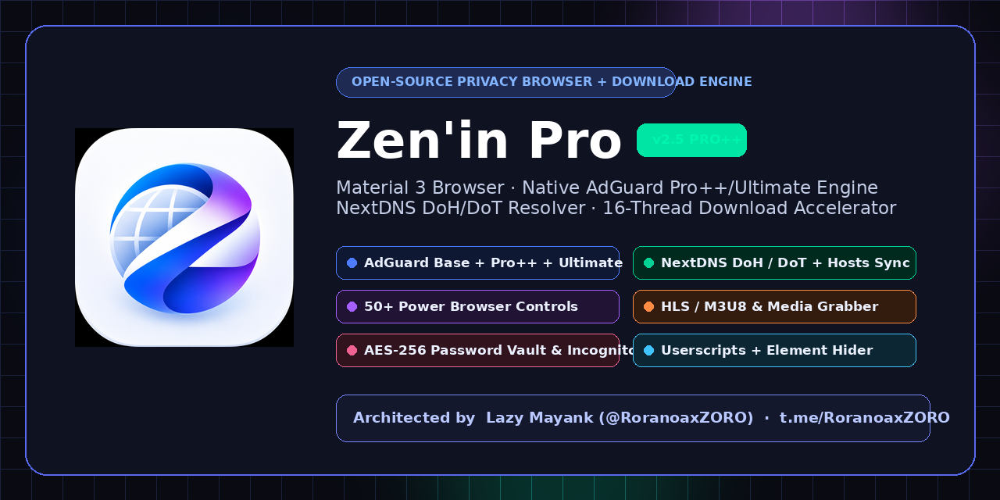

<div align="center">



<br/>


# ⚡ Zen'in Pro

### **Next-Gen Material 3 Privacy Browser · Native AdGuard Pro++/Ultimate Shield · NextDNS DoH/DoT Resolver · 16-Thread Download Accelerator**

[](https://github.com/RoranoaxZORO/Zenin-Pro/actions)
[](https://github.com/RoranoaxZORO/Zenin-Pro/releases/latest)
[](https://kotlinlang.org)
[](https://developer.android.com/jetpack/compose)
[](https://t.me/RoranoaxZORO)

</div>

---

## 👑 Owner & Lead Architect

| Field | Details |
| :--- | :--- |
| **Owner / Developer** | **ㅤᏞᴀᴢʏㅤᎷꫝʏᴀɴк まやんく** |
| **Handle** | [`@RoranoaxZORO`](https://t.me/RoranoaxZORO) |
| **Telegram** | [https://t.me/RoranoaxZORO](https://t.me/RoranoaxZORO) |
| **Application Name** | **Zen'in Pro** (`com.zeninpro.browser`) |

---

## 🚀 Overview

**Zen'in Pro** combines a multi-threaded **HTTP + HLS/M3U8 Download Manager Engine** (based on AB Download Manager's core) with a completely custom **Material 3 Cyber-Amethyst Privacy Browser** featuring a real, native **AdGuard + uBlock + EasyList Filtering Engine** and **NextDNS Encrypted DoH/DoT Integration**.

Every button, toggle, counter, and dialog in **Zen'in Pro** is backed by a real implementation—zero dummy counters, zero fake DNS statuses, and zero placeholder screens.

---

## 🛡️ Multi-Layer AdGuard & NextDNS Architecture

```
┌─────────────────────────────────────────────────────────────────────────┐
│                    Zen'in Pro — Cyber-Amethyst Material 3 UI            │
│       Shield HUD · Live Telemetry · 50+ Browser Controls · Tabs         │
└───────────────────┬─────────────────────────────────┬───────────────────┘
                    │                                 │
                    ▼                                 ▼
┌───────────────────────────────────────┐ ┌───────────────────────────────┐
│   Native AdGuard + uBlock Engine      │ │   16-Thread Download Engine   │
│ • Layer 1: Network Request Blocking   │ │ • Multi-Connection HTTP/HTTPS │
│ • Layer 2: Cosmetic CSS Injection ##  │ │ • HLS (.m3u8) Stream Merger   │
│ • Layer 3: URL Tracking Param Strip   │ │ • Smart Queues & Scheduler    │
│ • Layer 4: Anti-Adblock Scriptlets    │ │ • Auto-Resume & Checksum      │
└───────────────────┬───────────────────┘ └───────────────┬───────────────┘
                    │                                     │
                    └──────────────────┬──────────────────┘
                                       ▼
┌─────────────────────────────────────────────────────────────────────────┐
│             NextDNS Encrypted Resolver (DoH / DoT + Feed Sync)          │
│ • https://dns.nextdns.io/<PROFILE_ID>  &  <PROFILE_ID>.dns.nextdns.io   │
│ • Live DNS Ping/Latency Tester + OISD / HaGeZi Pro++ / StevenBlack Sync │
└─────────────────────────────────────────────────────────────────────────┘
```

### 1. Three Selectable Protection Profiles (`PRO` / `PRO++` / `ULTIMATE`)
* **AdGuard PRO (Balanced Daily Protection)**: Enables *AdGuard Base*, *AdGuard Tracking Protection*, *AdGuard URL Tracking*, and *AdGuard Mobile Ads*.
* **AdGuard PRO++ (Advanced Privacy & Cleanup)**: Adds *AdGuard Annoyances* (Cookie Notices, Popups, Widgets, Mobile App Banners) + *AdGuard Social Media* + *EasyPrivacy*.
* **AdGuard ULTIMATE (Maximum Multi-Layer Shield)**: Enables all 14+ built-in filter subscriptions including *NextDNS Recommended Hosts*, *Peter Lowe's Ad/Tracker List*, *AakList (Anti-Adblock Killer)*, *EasyList*, and *uBlock Filters*.

### 2. Full `Hosts & Filters` Manager
* **48,800+ Offline Seed Rules Bundled**: Works immediately on first launch even offline, with 1-tap online update & force-update via OkHttp.
* **Add Filter Source**: Subscribe to any online `.txt` filter URL or import local filter files from storage, with *Trusted Filter Source* scriptlet permissions.
* **Granular Whitelists & Custom Rules**: Manage per-website exceptions, allowed third-party hosts, manual ABP/AdGuard rules (`||domain.com^`, `@@||trusted.com^`, `domain.com##.ad-box`), disabled filters, and filter cache cleanup.
* **Interactive Element Hider**: Tap **"Hide element"** in the browser menu and tap any unwanted banner or overlay on a live webpage to automatically extract its CSS selector and hide it permanently.

### 3. Complete 50+ Power Browser Features
* **Isolated Incognito Mode**: Disables history logging, isolates session cookies, and disables DOM caching.
* **AES-256-GCM Password Manager**: Hardware Android Keystore encrypted credential vault with 1-tap webpage auto-fill.
* **Media & Stream Grabber**: Real-time sniffer for `.mp4`, `.m3u8` (HLS), `.mpd`, `.webm`, `.mp3`, `.aac`, and HTML5 `<video>`/`<audio>` tags with 1-tap download directly into the Zen'in Download Engine.
* **Page Resource Inspector**: Live network request logger categorized by *Media/HLS*, *Blocked Ads*, *JS/CSS*, *Images*, and *All*.
* **Userscripts Manager**: Built-in *YouTube Ad-Skipper & Sponsor Cleaner*, *Right-Click/Copy Unlocker*, and *HTML5 Stream Extractor*, plus custom JavaScript userscript support.
* **Reader Mode & Android TTS**: Clean distraction-free article view (Dark / Sepia / Light paper themes, adjustable font size) and native Android Text-to-Speech (*Read webpage aloud*).
* **Video & Offline Utilities**: *Force Video Fullscreen*, native *Picture-in-Picture (PiP)*, *Background Audio Play*, *Save Page Offline (`.mht` WebArchive)*, *Print to PDF*, *Import Cookies (`cookies.txt` / header)*, *View Page Source*, and *Built-in ZXing QR Scanner*.

---

## 📱 One-Command Termux Push & GitHub Auto-Release

You can create your GitHub repository, push the entire source code, and trigger the **GitHub Actions APK Build & Auto-Release** directly from **Termux** on Android:

```bash
chmod +x termux-push.sh
./termux-push.sh
```

What `termux-push.sh` does automatically:
1. Installs `git`, `curl`, `jq`, `unzip`, and `gh` in Termux if needed.
2. Creates your GitHub repository via the GitHub API.
3. Commits the complete **Zen'in Pro** source tree and pushes `main` + tag `v2.5.0`.
4. Triggers `.github/workflows/android-build-release.yml` on GitHub Actions, which compiles the Release & Debug APKs, signs them, generates SHA-256/MD5 checksums, and publishes them directly to your repository's **GitHub Releases** page.

---

## 🛠️ Manual Local Build Instructions

```bash
# Clone the repository
git clone https://github.com/RoranoaxZORO/Zenin-Pro.git
cd Zenin-Pro

# Build Android Debug & Release APKs
./gradlew :android:app:assembleDebug :android:app:assembleRelease
```

---

## 📄 License & Credits

* **Lead Architect**: **ㅤᏞᴀᴢʏㅤᎷꫝʏᴀɴк まやんく** ([@RoranoaxZORO](https://t.me/RoranoaxZORO))
* **Download Core Base**: Adapted from AB Download Manager (Apache-2.0 License).
* **Filter Rulesets**: Official AdGuard Filters & uBlock Origin compatible filter syntax (GPL-3.0 License).
